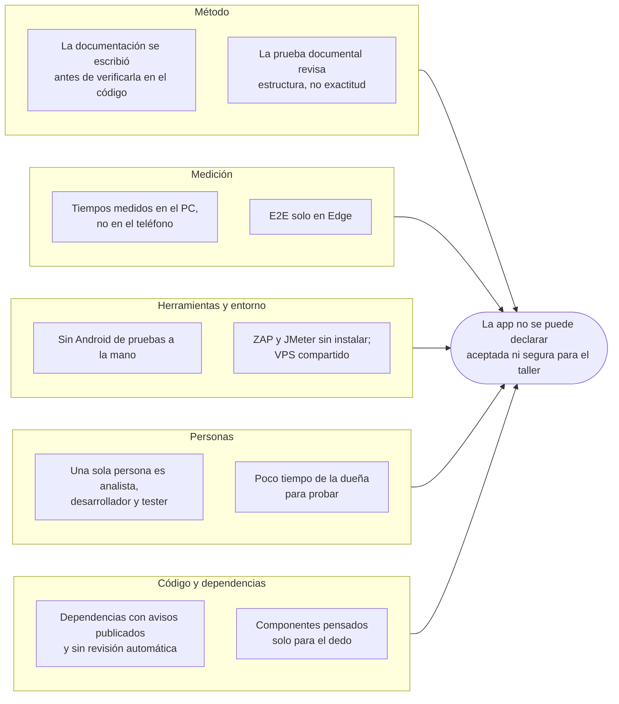
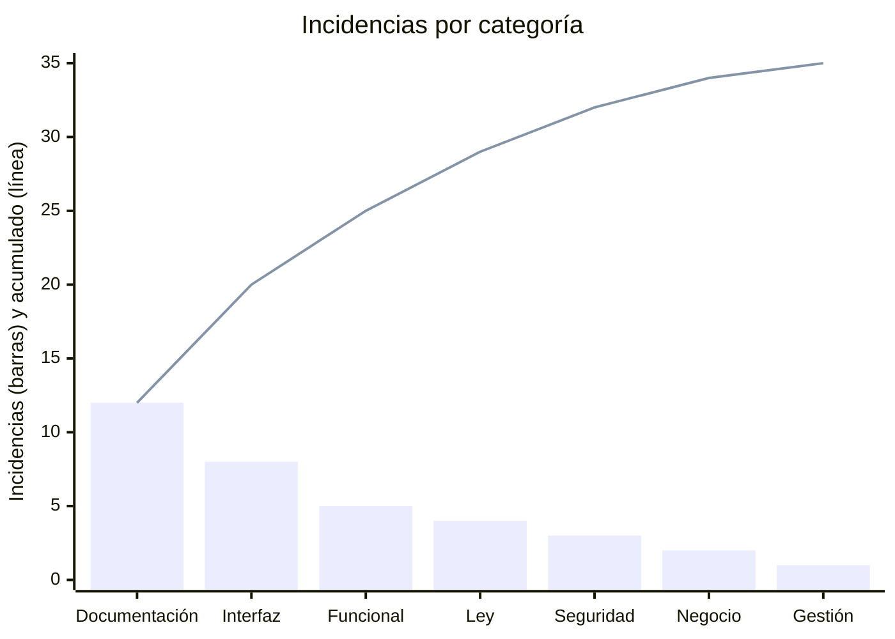

# Plan de mejora · Atelier Manager

Plan de mejora a partir del [informe de resultados](INFORME_DE_RESULTADOS.md) del 14 de octubre, el [reporte de defectos](REPORTE_DE_DEFECTOS.md) y la [revisión del 8 de octubre](revision-2026-10-08/INFORME.md). Sigue los pasos de la guía SENA *Aplicación de pruebas de software* (sección 2):
1. Diagnóstico.
2. Causas.
3. Objetivos.
4. Selección de acciones.
5. Planeación.
6. Seguimiento.

> **Fecha:** 14 de octubre de 2026 · **Responsable:** Cristian Cantillo Mejía · **Plazo final:** entrega del 23 al 25 de octubre de 2026

---

## 1. Diagnóstico: fortalezas, debilidades y áreas de mejora

| Fortalezas | Debilidades | Área de mejora |
| --- | --- | --- |
| Las 40 reglas de negocio tienen su prueba contra SQLite real; 388 pruebas pasan | Nada se ha probado en el teléfono de la dueña ni con ella | **Validación con la usuaria y el dispositivo** |
| La CI corre pruebas, cobertura con mínimo, SonarCloud y la imagen Docker en cada cambio | La CI no revisa vulnerabilidades de las dependencias; hoy hay 2 críticas | **Seguridad de dependencias y despliegue** |
| Documentación completa por fases, con una prueba que la compara con el código | La documentación promete en varios puntos más de lo que la app hace | **Exactitud de la documentación** |
| Offline-first, copias cifradas con AES-256-GCM y bloqueo al volver | Mensajes que anuncian éxito sin haberlo, acciones escondidas tras un gesto | **Interfaz y mensajes** |

Las fortalezas se usan para cubrir las debilidades. Por ejemplo, la misma CI que ya corre las pruebas puede correr `npm audit`, y la prueba documental puede crecer con los casos de este plan.

## 2. Causas

### 2.1 Diagrama de causa y efecto

Problema: **la app no se puede declarar aceptada ni segura para el taller.**

### 2.2 Pareto de las incidencias

Las 35 incidencias abiertas son los 31 hallazgos de la revisión del 8 de octubre más los 4 defectos nuevos del 14 de octubre. Se agruparon por categoría:

| Categoría | Incidencias | Cantidad | % | % acumulado |
| --- | --- | --- | --- | --- |
| Documentación que promete de más o está desactualizada | H06, H09, H10, H12, H13, H14, H15, H16, H20, H22, H30, H31 | 12 | 34,3 | 34,3 |
| Interfaz y mensajes | H17, H18, H23, H24, H25, H26, H27, DEF-09 | 8 | 22,9 | 57,1 |
| Funcional | H05, H07, H08, H11, H19 | 5 | 14,3 | 71,4 |
| Datos personales y ley | H01, H02, H03, H04 | 4 | 11,4 | 82,9 |
| Seguridad | DEF-01, DEF-02, DEF-03 | 3 | 8,6 | 91,4 |
| Decisiones de negocio pendientes | H21, H28 | 2 | 5,7 | 97,1 |
| Gestión de la entrega | H29 | 1 | 2,9 | 100,0 |

Tres categorías (documentación, interfaz y funcional) suman el 71 % de las incidencias. Pero el Pareto cuenta cantidad, no gravedad: las de seguridad son pocas e incluyen la única crítica (DEF-01), así que se priorizan aunque estén a la derecha.

## 3. Objetivos

| ID | Objetivo | Indicador | Fecha límite |
| --- | --- | --- | --- |
| O1 | Que las dependencias de producción no tengan vulnerabilidades críticas ni altas | `npm audit --omit=dev` en 0 críticas y 0 altas, y la CI lo comprueba | 16 oct |
| O2 | Corregir los defectos de código que no dependen de una decisión de la dueña | DEF-04, DEF-05, DEF-06, DEF-08, DEF-09, DEF-10, DEF-11 y DEF-12 en estado *Verificado* | 18 oct |
| O3 | Que el manual y el SRS digan solo lo que la app hace | Incidencias de documentación y de ley con su criterio de cierre cumplido | 21 oct |
| O4 | Probar con la dueña y en su teléfono | CPV-25, CPV-26 y CPV-27 ejecutados y registrados, con cada falla convertida en defecto | 21 oct |
| O5 | Cerrar las pruebas de seguridad y carga de la versión web | CPV-21, CPV-23 y CPV-24 exitosos | 22 oct |

## 4. Acciones de mejora

### 4.1 Selección

| Problema | Causa | Objetivo | Acción |
| --- | --- | --- | --- |
| Vulnerabilidad crítica en el APK (DEF-01, DEF-02) | Dependencias sin revisión automática | O1 | A1. `npm audit fix`, compilar el APK y agregar `npm audit --omit=dev --audit-level=high` a la CI |
| Entrega con deuda sin advertir (DEF-04) | Dos caminos de entrega con lógica distinta | O2 | A2. Misma advertencia de saldo al entregar prenda por prenda, con prueba |
| El manual pide acciones que la app no tiene (H01, H02, H05, H21) | Documentación antes de verificar | O3 | A3. Corregir esas instrucciones del manual |
| Mensajes de éxito falsos y tutorial (DEF-05, DEF-11, DEF-12) | El aviso no depende del resultado | O2 | A4. Éxito solo si hubo resultado; tutorial que distingue cerrar de terminar; texto del botón de recordatorios |
| Cabeceras de seguridad (DEF-03) | La configuración de nginx se hizo antes de revisar seguridad | O5 | A5. CSP y Permissions-Policy en `docker/seguridad.inc`; HSTS y `server_tokens off` en el nginx del VPS |
| Defectos de interfaz y archivos (DEF-06, DEF-08, DEF-09, DEF-10) | Componentes pensados solo para el dedo; estilos sin tokens comunes | O2 | A6. Borrado físico de fotos, menú de acciones con teclado, campo de usuario oculto y tokens CSS |
| Reglas sin decidir (DEF-07, H28, H21) | Falta confirmar con la dueña | O3 | A7. Reunión corta con la dueña: orden de las listas, recepción sin precio o fecha, devoluciones |
| Sin evidencia en el teléfono | Sin Android de pruebas | O4 | A8. Instalar el APK nuevo y ejecutar CPV-26 y la medición de RNF-01 a RNF-03 |
| Sin aceptación ni usabilidad | Poco tiempo de la dueña | O4 | A9. Una sesión con la dueña: CPV-25 y CPV-27, con datos inventados |
| ZAP y JMeter pendientes | Herramientas no instaladas; VPS compartido | O5 | A10. ZAP de línea base y JMeter contra el contenedor local, o en el VPS con autorización |
| Diagramas y matriz desactualizados (H09, H10, H12, H13, H15) | La prueba documental no revisa exactitud | O3 | A11. Actualizar diagramas de estados, secuencia de bloqueo, capas y trazabilidad |
| Resultados viejos tras los cambios | Las correcciones pueden romper otra cosa | Todos | A12. Regresión completa y nuevo informe de resultados |

### 4.2 Priorización

Criterios de la guía (sección 2.2):
- **Dificultad:** Mucha, Bastante, Poca o Ninguna.
- **Plazo:** Largo, Medio, Corto o Inmediato.
- **Impacto:** Ninguno, Poco, Bastante o Mucho.

Primero va lo de mucho impacto y poca dificultad. Lo que depende de la dueña se agenda en cuanto ella pueda.

| Prioridad | Acción | Dificultad | Plazo | Impacto |
| --- | --- | --- | --- | --- |
| 1 | A1. Dependencias y revisión en la CI | Poca | Inmediato | Mucho |
| 2 | A2. Advertencia de deuda en la entrega por prenda | Poca | Inmediato | Mucho |
| 3 | A3. Instrucciones del manual | Poca | Corto | Mucho |
| 4 | A7. Decisiones con la dueña | Poca | Corto | Mucho |
| 5 | A9. Aceptación y usabilidad con la dueña | Bastante | Corto | Mucho |
| 6 | A8. APK en el teléfono y tiempos reales | Bastante | Corto | Mucho |
| 7 | A4. Mensajes y tutorial | Poca | Corto | Bastante |
| 8 | A5. Cabeceras de seguridad | Poca | Corto | Bastante |
| 9 | A6. Interfaz y archivos | Bastante | Corto | Bastante |
| 10 | A11. Diagramas y trazabilidad | Bastante | Medio | Bastante |
| 11 | A10. ZAP y JMeter | Bastante | Medio | Bastante |
| 12 | A12. Regresión e informe final | Poca | Corto | Mucho |

## 5. Planeación y seguimiento

Estructura de la guía (figura 18). La columna *Estado* se actualiza cada día hasta la entrega. Las fechas de octubre de 2026 caen así:
- 15 jueves, 16 viernes, 17 sábado, 18 domingo.
- 19 lunes, 20 martes, 21 miércoles, 22 jueves.

| Acción | Responsable | Inicio | Fin | Recursos | Indicador de seguimiento | Estado |
| --- | --- | --- | --- | --- | --- | --- |
| A1 | Cristian | 15 oct | 15 oct | PC, Android Studio | `npm audit --omit=dev`: 0 críticas, 0 altas; paso nuevo en la CI | Pendiente |
| A2 | Cristian | 15 oct | 15 oct | PC | Prueba nueva que reproduce DEF-04 y pasa | Pendiente |
| A3 | Cristian | 16 oct | 16 oct | Revisión del 8 oct | Criterios de cierre de H01, H02, H05 y H21 cumplidos | Pendiente |
| A4 | Cristian | 16 oct | 16 oct | PC | DEF-05, DEF-11 y DEF-12 *Verificado* | Pendiente |
| A5 | Cristian y administración del VPS | 17 oct | 17 oct | Acceso `sudo` al VPS | CPV-21 exitoso | Pendiente |
| A6 | Cristian | 17 oct | 18 oct | PC | DEF-06, DEF-08, DEF-09 y DEF-10 *Verificado* | Pendiente |
| A7 | Cristian con la dueña | 18 oct | 18 oct | 30 minutos de la dueña | Decisiones escritas en DECISIONES.md; DEF-07 y H28 resueltos | Pendiente |
| A8 | Cristian | 19 oct | 19 oct | Teléfono Android | CPV-26 ejecutado; tiempos de RNF-01 a RNF-03 en el teléfono | Pendiente |
| A9 | Cristian con la dueña | 19 oct | 20 oct | Teléfono de la dueña, 1 hora | CPV-25 y CPV-27 con la hoja llenada | Pendiente |
| A10 | Cristian | 20 oct | 20 oct | ZAP, JMeter, Java 21 | CPV-23 y CPV-24 con sus informes en `evidencias/` | Pendiente |
| A11 | Cristian | 20 oct | 21 oct | PC | Criterios de cierre de H09, H10, H12, H13 y H15 cumplidos; prueba documental en verde | Pendiente |
| A12 | Cristian | 22 oct | 22 oct | PC, teléfono | Informe de resultados nuevo, sin casos fallidos abiertos sin plan | Pendiente |

**Cómo se hace el seguimiento:**
- Cada defecto corregido pasa a *Reabierto* (vuelve a pruebas) y a *Verificado* cuando su método de reproducción ya no lo muestra. Se cierra con la regresión de A12.
- Una acción que no se cumpla en su fecha se anota con la causa y la fecha nueva; no se borra.
- El 22 de octubre se repite este documento con los estados finales, junto al nuevo informe de resultados.
