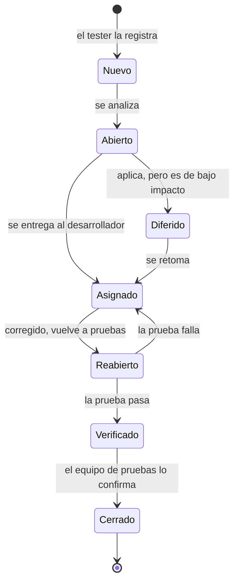

# Reporte de defectos · Atelier Manager

Un reporte por defecto, con la estructura de la guía SENA *Aplicación de pruebas de software* (sección 1.3): identificador, título, reportado por, asignado a, fecha de creación, severidad, aplicación, descripción, método de reproducción e información adicional. Cada uno tiene su estado en el ciclo de vida de una incidencia.

> **Aplicación:** Atelier Manager (Costura App) 1.2.0 · **Corte:** 14 de octubre de 2026, actualizado ese mismo día tras corregir DEF-01, DEF-02, DEF-04, DEF-05, DEF-11 y DEF-12 · **Casos de prueba:** [CASOS_DE_PRUEBA](CASOS_DE_PRUEBA.md) · **Resultados:** [INFORME_DE_RESULTADOS](INFORME_DE_RESULTADOS.md)

---

## 1. Cómo se gestiona una incidencia

Los estados son los de la guía (figura 11). *Reabierto* significa, como en la guía, que la corrección volvió al equipo de pruebas.

**Severidad:**

| Severidad | Criterio |
| --- | --- |
| Crítica | Expone datos o permite ejecutar contenido ajeno dentro de la app |
| Alta | Puede hacer perder dinero o una advertencia que el SRS promete |
| Media | Funciona mal o confunde, pero hay una forma de seguir trabajando |
| Baja | Detalle visual, de accesibilidad o de texto sin efecto en los datos |

## 2. Resumen

| ID | Título | Severidad | Estado | Caso | Origen |
| --- | --- | --- | --- | --- | --- |
| [DEF-01](#def-01) | Capacitor Android con una vulnerabilidad crítica publicada | Crítica | Verificado | CPV-20 | Pruebas del 14 oct |
| [DEF-02](#def-02) | Otras seis dependencias con vulnerabilidades críticas o altas | Media | Verificado | CPV-20 | Pruebas del 14 oct |
| [DEF-03](#def-03) | Faltan cabeceras de seguridad en la versión web | Media | Nuevo | CPV-21 | Pruebas del 14 oct |
| [DEF-04](#def-04) | Entregar la última prenda cierra la orden con deuda sin advertir | Alta | Verificado | — | Revisión del 8 oct, H11 |
| [DEF-05](#def-05) | Cancelar la cámara muestra «Fotografía guardada» | Media | Verificado | CPV-28 | Revisión del 8 oct, H17 |
| [DEF-06](#def-06) | Eliminar una foto deja el archivo en el teléfono | Media | Abierto | — | Revisión del 8 oct, H07 |
| [DEF-07](#def-07) | Las órdenes no se ordenan por fecha de entrega | Media | Abierto | — | Revisión del 8 oct, H08 |
| [DEF-08](#def-08) | Anular y eliminar solo se alcanzan deslizando el dedo | Media | Abierto | — | Revisión del 8 oct, H24 |
| [DEF-09](#def-09) | Formularios de contraseña sin campo de usuario | Baja | Nuevo | CPV-14 a CPV-16 | Pruebas del 14 oct |
| [DEF-10](#def-10) | Siete variables de estilo usadas sin definir | Baja | Abierto | — | Revisión del 8 oct, H25 |
| [DEF-11](#def-11) | El tutorial dice «Misión Completada» al cerrarlo a medias | Baja | Verificado | — | Revisión del 8 oct, H26 |
| [DEF-12](#def-12) | «Recordar a N clientes» cuenta órdenes, no clientas | Baja | Verificado | — | Revisión del 8 oct, H18 |

**Por severidad:** 1 crítica, 1 alta, 6 medias y 4 bajas. **Por estado:** 6 verificados (DEF-01, DEF-02, DEF-04, DEF-05, DEF-11 y DEF-12), 2 nuevos (DEF-03 y DEF-09) y 4 abiertos. Ninguno está cerrado: los verificados se cierran en la regresión final (acción A12 del plan de mejora).

## 3. Reportes

### DEF-01 · Capacitor Android con una vulnerabilidad crítica publicada

| Campo | Valor |
| --- | --- |
| Identificador | DEF-01 |
| Título | `@capacitor/android` 8.4.0 está afectado por GHSA-rvm3-566m-v7fv |
| Reportado por | Ejecución de pruebas del 14 oct 2026 (CPV-20) |
| Asignado a | Cristian Cantillo Mejía (desarrollador) |
| Fecha de creación | 14 de octubre de 2026 |
| Severidad | Crítica (la que asigna el aviso) |
| Estado | Verificado |
| Aplicación | Atelier Manager 1.2.0, APK de Android |
| Descripción | El aviso publica que, en las versiones 8.3.5 a 8.4.2, contenido remoto puede cargarse con el origen de la app a través de la ruta interna del proxy HTTP. La app carga solo sus propios archivos, lo que reduce la exposición, pero la librería viaja dentro del APK. Hay corrección en la 8.4.3 sin cambios incompatibles |
| Método de reproducción | 1. `npm ci`. 2. `npm audit --omit=dev`. Resultado: `@capacitor/android critical >=8.3.5 <8.4.3` |
| Información adicional | `npm ls` muestra `@capacitor/android@8.4.0`. Al actualizar hay que compilar el APK otra vez y repetir CPV-26 en el teléfono. Evidencia: [seguridad.txt](evidencias/2026-10-14/seguridad.txt) |
| Corrección | PR #15 (`809cfb8`, 14 oct): `@capacitor/android`, `core` y `cli` en 8.4.3. Un `overrides` deja una sola copia de `@capacitor/core` en el árbol |
| Verificación | 14 oct, sobre `809cfb8`. `npm audit --omit=dev` da 0 vulnerabilidades, y el paso nuevo de la CI que lo comprueba pasa. `./gradlew assembleDebug` compiló con JDK 21 en la rama del PR (`beeeaf2`, mismas dependencias). Pasa a *Cerrado* cuando el APK nuevo supere CPV-26 en el teléfono |

### DEF-02 · Otras seis dependencias con vulnerabilidades críticas o altas

| Campo | Valor |
| --- | --- |
| Identificador | DEF-02 |
| Título | `@capacitor/ios`, `vue`, `@vue/server-renderer`, `nanoid`, `postcss` y `source-map-js` con avisos publicados |
| Reportado por | Ejecución de pruebas del 14 oct 2026 (CPV-20) |
| Asignado a | Cristian Cantillo Mejía |
| Fecha de creación | 14 de octubre de 2026 |
| Severidad | Media |
| Estado | Verificado |
| Aplicación | Atelier Manager 1.2.0, dependencias de producción |
| Descripción | `@capacitor/ios` tiene el mismo aviso crítico que DEF-01, pero la app no se compila para iOS. Las otras cinco son altas. El aviso de Vue (GHSA-g2v6-rqmx-r4w6) afecta el renderizado en servidor, que la app no usa. `nanoid`, `postcss` y `source-map-js` actúan al compilar. Por eso la severidad real es media, aunque todas tienen corrección |
| Método de reproducción | `npm audit --omit=dev` |
| Información adicional | Se corrigen junto con DEF-01 con `npm audit fix` y la suite completa. Las 7 vulnerabilidades adicionales de las herramientas de desarrollo no llegan al APK |
| Corrección | PR #15: `vue` 3.5.43, `@capacitor/ios` 8.4.3 por `overrides`, `vitest` 4.1.11 y las transitivas actualizadas |
| Verificación | 14 oct, sobre `809cfb8`. `npm audit` da 0 vulnerabilidades, también en desarrollo. Pasan 388 pruebas unitarias y 3 E2E, y la versión web publicada carga con Vue 3.5.43 |

### DEF-03 · Faltan cabeceras de seguridad en la versión web

| Campo | Valor |
| --- | --- |
| Identificador | DEF-03 |
| Título | Sin `Content-Security-Policy`, `Strict-Transport-Security` ni `Permissions-Policy`; `Server` revela la versión |
| Reportado por | Ejecución de pruebas del 14 oct 2026 (CPV-21) |
| Asignado a | Cristian Cantillo Mejía (contenedor) y administración del VPS (nginx del servidor) |
| Fecha de creación | 14 de octubre de 2026 |
| Severidad | Media |
| Estado | Nuevo |
| Aplicación | Versión web en `https://proyectosena.online/costura-app/` |
| Descripción | Están `X-Frame-Options`, `X-Content-Type-Options` y `Referrer-Policy`, y HTTP redirige a HTTPS. Faltan una política de contenido que limite de dónde se cargan scripts, la orden al navegador de usar siempre HTTPS y la política de permisos. `Server: nginx/1.24.0 (Ubuntu)` muestra producto, versión y sistema |
| Método de reproducción | `curl -I https://proyectosena.online/costura-app/` |
| Información adicional | La CSP va en `docker/seguridad.inc` (contenedor). HSTS y `server_tokens off` van en el nginx del servidor, que es compartido. La CSP debe permitir Google Fonts mientras la app las cargue (H30) |

### DEF-04 · Entregar la última prenda cierra la orden con deuda sin advertir

| Campo | Valor |
| --- | --- |
| Identificador | DEF-04 |
| Título | La entrega prenda por prenda no muestra la advertencia de saldo de RN-30 |
| Reportado por | Revisión de documentación y app del 8 oct 2026 (H11) |
| Asignado a | Cristian Cantillo Mejía |
| Fecha de creación | 8 de octubre de 2026 · confirmado en el código el 14 de octubre |
| Severidad | Alta |
| Estado | Verificado |
| Aplicación | Atelier Manager 1.2.0, detalle de la orden |
| Descripción | El botón *Entregar orden* pide confirmación mostrando lo que se debe (`cambiarEstado`, `OrdenDetailView.vue:221`). Marcar *Entregada* prenda por prenda (`handleEstadoPrenda`, línea 299) no la pide, y al entregar la última la orden queda *Entregada* con saldo. La decisión D-11 permite entregar con deuda, pero siempre advirtiendo |
| Método de reproducción | 1. Orden con dos prendas terminadas, total 40.000 y abono 10.000. 2. En *Prendas*, tocar *Entregada* en la primera. 3. Tocar *Entregada* en la segunda. Esperado: advertencia con 30.000. Obtenido: la orden queda *Entregada* sin advertencia |
| Información adicional | Puede llevar a entregar ropa sin cobrar. La corrección es mostrar la misma advertencia en ambos caminos, sin bloquear la entrega |
| Corrección | 14 oct: `handleEstadoPrenda` pide la misma confirmación (`mensajeConfirmacionEntrega(orden, 'esta prenda')`) antes de entregar una prenda con saldo, también la última. Sin saldo entrega directo. La entrega con deuda sigue permitida (D-11) |
| Verificación | 14 oct. Tres pruebas nuevas contra SQLite real en `OrdenDetailView.aviso.spec.js`: sin confirmar, la prenda no cambia; al confirmar se entrega, y la última vuelve a advertir antes de cerrar la orden; sin saldo no pregunta. En Edge, siguiendo el método de reproducción, aparece «¿Entregar esta prenda de todos modos?» con el saldo. Pasan 392 pruebas unitarias y 3 E2E |

### DEF-05 · Cancelar la cámara muestra «Fotografía guardada»

| Campo | Valor |
| --- | --- |
| Identificador | DEF-05 |
| Título | Mensaje de éxito cuando no se guardó ninguna foto |
| Reportado por | Revisión del 8 oct 2026 (H17); caso exploratorio CPV-28 |
| Asignado a | Cristian Cantillo Mejía |
| Fecha de creación | 8 de octubre de 2026 · confirmado en el código el 14 de octubre |
| Severidad | Media |
| Estado | Verificado |
| Aplicación | Atelier Manager 1.2.0, fotos de la prenda |
| Descripción | `takePhoto` (`usePrendas.js`) devuelve `null` cuando la modista cancela, pero `useAsyncAction` muestra el `successMessage` siempre que la función no lance error. Incumple RNF-05: «no mostrar éxito si falló» |
| Método de reproducción | 1. Abrir una prenda. 2. *Fotos* → *Tomar foto*. 3. Cancelar la cámara. Esperado: ningún mensaje. Obtenido por el código: «Fotografía guardada» |
| Información adicional | Verificado leyendo el código; falta reproducirlo en el teléfono (CPV-26) |
| Corrección | 14 oct: `takePhoto` ya no tiene mensajes propios; los muestra solo `handleTakePhoto`, y el de éxito solo si hay foto guardada. Al reproducirlo apareció algo más: con una foto real, «Fotografía guardada» salía dos veces, y un error de la cámara también se repetía. Quedan en uno |
| Verificación | 14 oct. Tres pruebas nuevas de la pantalla contra SQLite real en `OrdenDetailView.aviso.spec.js`, que fallaban antes del cambio: al cancelar no hay aviso ni foto; con una foto real hay una fila y un aviso; con un error de la cámara, un solo mensaje de error. Falta repetir CPV-28 en el teléfono |

### DEF-06 · Eliminar una foto deja el archivo en el teléfono

| Campo | Valor |
| --- | --- |
| Identificador | DEF-06 |
| Título | `removeFoto` borra la fila pero no el archivo |
| Reportado por | Revisión del 8 oct 2026 (H07) |
| Asignado a | Cristian Cantillo Mejía |
| Fecha de creación | 8 de octubre de 2026 · confirmado el 14 de octubre |
| Severidad | Media |
| Estado | Abierto |
| Aplicación | Atelier Manager 1.2.0, fotos de la prenda |
| Descripción | `removeFoto` (`usePrendas.js:159`) llama a `deleteFotografia`, que borra la fila y escribe el historial, pero no llama a `deletePhotoFile`. Eliminar una prenda sí borra sus archivos (línea 83). La foto desaparece de la galería y sigue ocupando espacio |
| Método de reproducción | 1. Tomar una foto. 2. Eliminarla. 3. Revisar la carpeta de datos de la app. Esperado: archivo borrado. Obtenido: el archivo sigue ahí |
| Información adicional | Relacionado con la supresión de datos personales (H01) |

### DEF-07 · Las órdenes no se ordenan por fecha de entrega

| Campo | Valor |
| --- | --- |
| Identificador | DEF-07 |
| Título | Activas e Historial se ordenan por fecha de creación (RF-09) |
| Reportado por | Revisión del 8 oct 2026 (H08) |
| Asignado a | Cristian Cantillo Mejía |
| Fecha de creación | 8 de octubre de 2026 · confirmado el 14 de octubre |
| Severidad | Media |
| Estado | Abierto |
| Aplicación | Atelier Manager 1.2.0, pantalla Órdenes |
| Descripción | `getAllOrdenes` usa `ORDER BY o.fecha_creacion DESC` (`ordenes.js:11`). RF-09 pide ordenar por fecha de entrega y el SRS lo marca *Cumple* |
| Método de reproducción | 1. Crear una orden con entrega en 7 días. 2. Crear otra con entrega mañana. Esperado en *Activas*: primero la de mañana. Obtenido: primero la última creada |
| Información adicional | Se corrige el orden o se revisa RF-09 con la dueña; en ambos casos se actualiza el SRS |

### DEF-08 · Anular y eliminar solo se alcanzan deslizando el dedo

| Campo | Valor |
| --- | --- |
| Identificador | DEF-08 |
| Título | `SwipeItem` no tiene alternativa con botón, ratón ni teclado |
| Reportado por | Revisión del 8 oct 2026 (H24) |
| Asignado a | Cristian Cantillo Mejía |
| Fecha de creación | 8 de octubre de 2026 · confirmado el 14 de octubre |
| Severidad | Media |
| Estado | Abierto |
| Aplicación | Atelier Manager 1.2.0, listas de pagos y prendas |
| Descripción | El botón de la acción solo aparece con `touchstart`, `touchmove` y `touchend`. En la versión web con ratón, o con teclado, no hay forma de anular un pago |
| Método de reproducción | 1. Abrir la versión web en un computador. 2. Ir a *Pagos* de una orden con un abono. 3. Intentar anularlo con el ratón o con Tab. Obtenido: no hay acción visible |
| Información adicional | Propuesta P4 de [PROPUESTA_UX](revision-2026-10-08/PROPUESTA_UX.md) |

### DEF-09 · Formularios de contraseña sin campo de usuario

| Campo | Valor |
| --- | --- |
| Identificador | DEF-09 |
| Título | El navegador advierte que los formularios de contraseña no tienen campo de usuario |
| Reportado por | Ejecución de pruebas del 14 oct 2026 (consola durante CPV-14 a CPV-16) |
| Asignado a | Cristian Cantillo Mejía |
| Fecha de creación | 14 de octubre de 2026 |
| Severidad | Baja |
| Estado | Nuevo |
| Aplicación | Atelier Manager 1.2.0, cambio de clave y pantalla de bloqueo |
| Descripción | `CambiarPasswordView.vue` y `AppLockScreen.vue` tienen campos de contraseña sin un campo de usuario, ni siquiera oculto. Chromium lo marca como problema de accesibilidad y los gestores de contraseñas no saben a qué cuenta pertenecen |
| Método de reproducción | `PW_CHANNEL=msedge npx playwright test` y revisar la consola: «Password forms should have (optionally hidden) username fields» (2 veces) |
| Información adicional | Basta un campo `username` oculto con `autocomplete="username"` |

### DEF-10 · Siete variables de estilo usadas sin definir

| Campo | Valor |
| --- | --- |
| Identificador | DEF-10 |
| Título | 39 usos de variables CSS que no existen |
| Reportado por | Revisión del 8 oct 2026 (H25) |
| Asignado a | Cristian Cantillo Mejía |
| Fecha de creación | 8 de octubre de 2026 · confirmado el 14 de octubre |
| Severidad | Baja |
| Estado | Abierto |
| Aplicación | Atelier Manager 1.2.0, estilos |
| Descripción | `--border-color` (10 usos), `--text-secondary` (10), `--text-primary` (6), `--error-color` (6), `--bg-secondary` (4), `--accent-color` (2) y `--primary-fixed` (1) no se definen en ningún archivo. Esas declaraciones quedan inválidas: pueden perderse bordes, el color de los errores o el anillo de foco |
| Método de reproducción | Buscar `var(--border-color` y `--border-color:` en `src/`: hay usos y ninguna definición |
| Información adicional | Se cambian por los tokens que ya existen; no hace falta rediseñar |

### DEF-11 · El tutorial dice «Misión Completada» al cerrarlo a medias

| Campo | Valor |
| --- | --- |
| Identificador | DEF-11 |
| Título | Cerrar el recorrido cuenta como terminarlo |
| Reportado por | Revisión del 8 oct 2026 (H26) |
| Asignado a | Cristian Cantillo Mejía |
| Fecha de creación | 8 de octubre de 2026 · confirmado el 14 de octubre |
| Severidad | Baja |
| Estado | Verificado |
| Aplicación | Atelier Manager 1.2.0, Ayuda |
| Descripción | Los recorridos de `useTutorial.js` usan `onDestroyed: handleTourCompletion`, que se ejecuta también cuando se cierra el recorrido sin terminarlo |
| Método de reproducción | 1. *Ajustes* → *Ayuda*. 2. Empezar un recorrido. 3. Cerrarlo en el segundo paso. Obtenido: «¡Misión Completada!» |
| Información adicional | Propuesta P6 de PROPUESTA_UX |
| Corrección | 14 oct: `handleTourCompletion` usa el índice que driver.js le pasa a `onDestroyed`. Solo muestra «¡Misión Completada!» si el recorrido se cerró en el último paso; en los dos casos vuelve a Ayuda |
| Verificación | 14 oct. Seis pruebas nuevas en `useTutorial.spec.js` (los tres recorridos: cerrado a mitad y terminado); las tres de cerrar a mitad fallaban antes del cambio. En Edge, con el driver.js real: cerrar el recorrido de clientes en el segundo paso no muestra nada, y terminarlo (3 pasos) muestra el aviso una vez |

### DEF-12 · «Recordar a N clientes» cuenta órdenes, no clientas

| Campo | Valor |
| --- | --- |
| Identificador | DEF-12 |
| Título | El botón del panel usa el número de órdenes listas como número de clientas |
| Reportado por | Revisión del 8 oct 2026 (H18) |
| Asignado a | Cristian Cantillo Mejía |
| Fecha de creación | 8 de octubre de 2026 · confirmado el 14 de octubre |
| Severidad | Baja |
| Estado | Verificado |
| Aplicación | Atelier Manager 1.2.0, panel de inicio |
| Descripción | `DashboardView.vue:110` muestra «Recordar a los N clientes» con `kpis.ordenesListas`. Además, el botón no le escribe a la clienta: le manda a la modista una lista por Telegram |
| Método de reproducción | 1. Una clienta con dos órdenes listas. 2. Abrir *Inicio*. Esperado: «1 clienta» o «2 órdenes». Obtenido: «Recordar a los 2 clientes» |
| Información adicional | Propuesta P7 de PROPUESTA_UX: «Preparar recordatorios (N órdenes)» |
| Corrección | 14 oct: el botón dice «Preparar recordatorios». No lleva número: la tarjeta ya muestra cuántas órdenes están listas, y las que entraron hoy en la lista no se repiten (RN-33). El aviso dice «Te llegó a Telegram la lista con N órdenes para recordar. Ábrela y envía cada WhatsApp.», y si no hay nada nuevo, «Los recordatorios de hoy ya están en tu Telegram.» en lugar de «Ya se les recordó hoy a estos clientes». El manual se corrigió igual |
| Verificación | 14 oct. Cuatro pruebas nuevas en `DashboardView.spec.js`, que fallaban antes del cambio: el botón no dice «clientes»; el aviso cuenta órdenes, en plural y en singular; y sin órdenes nuevas no afirma que se le recordó a nadie |

## 4. Otras incidencias abiertas

La [revisión del 8 de octubre](revision-2026-10-08/INFORME.md) registró 31 hallazgos. Los de código están arriba como DEF-04 a DEF-08 y DEF-10 a DEF-12. Los demás son de documentación, de datos personales o decisiones de negocio pendientes. Siguen en estado *Abierto* con su criterio de cierre en ese informe y entran en el [plan de mejora](PLAN_DE_MEJORA.md).
