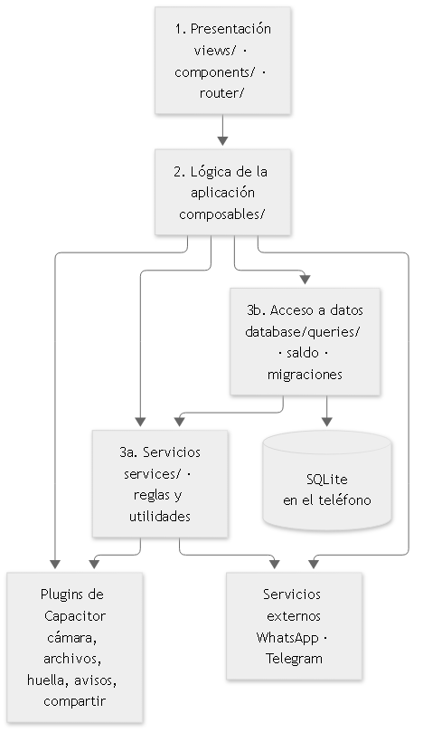
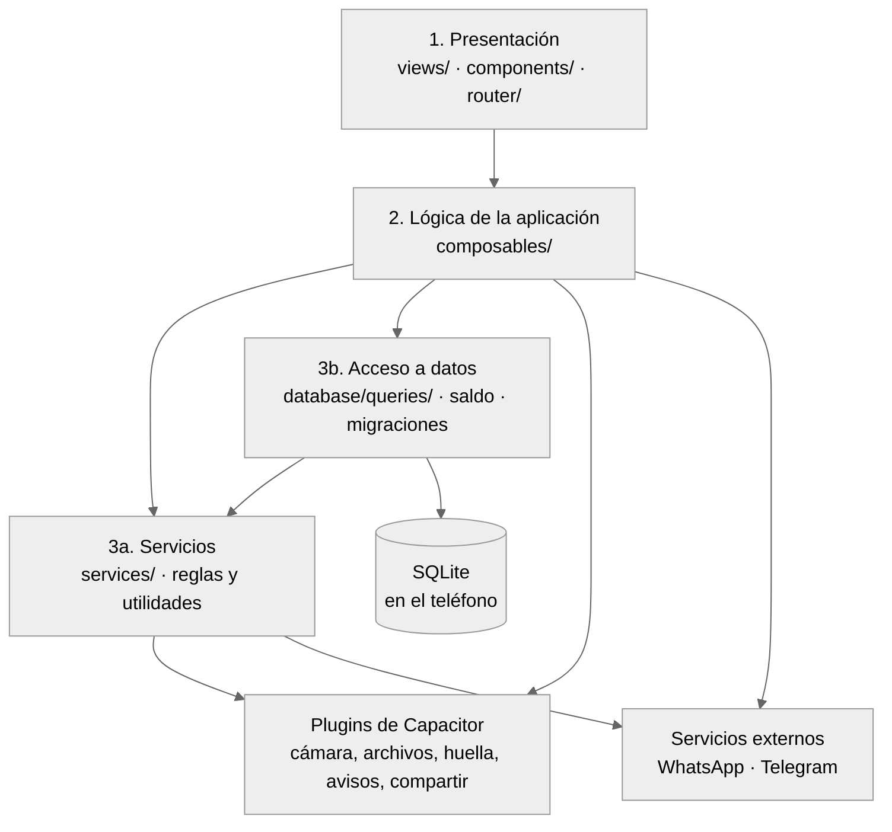
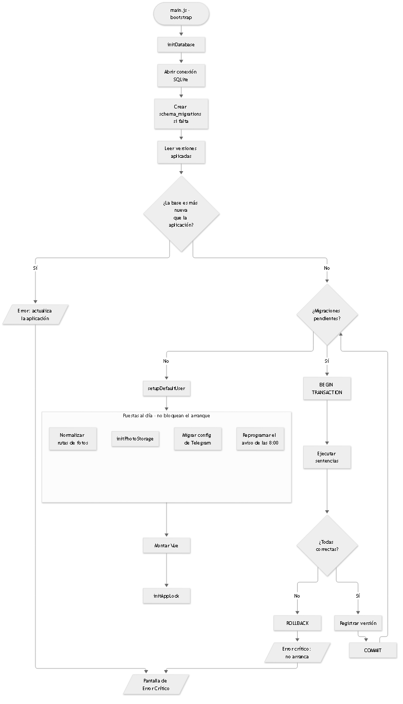
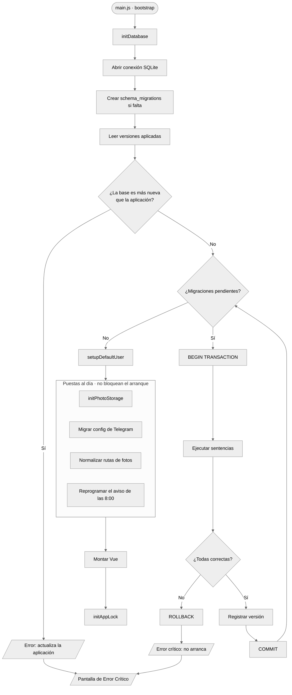
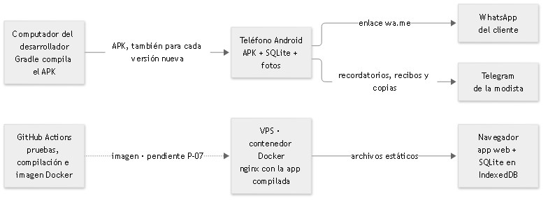
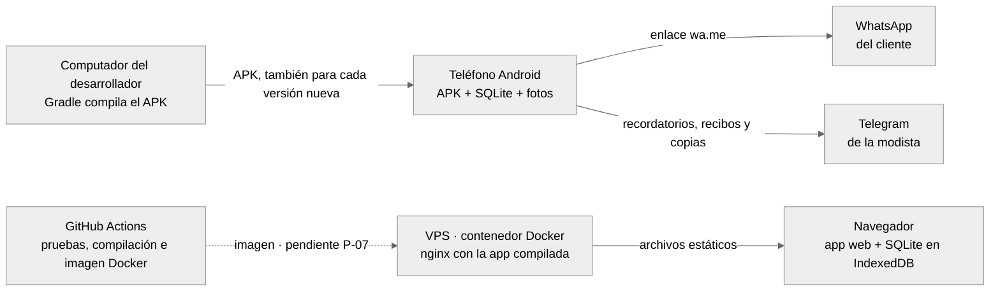
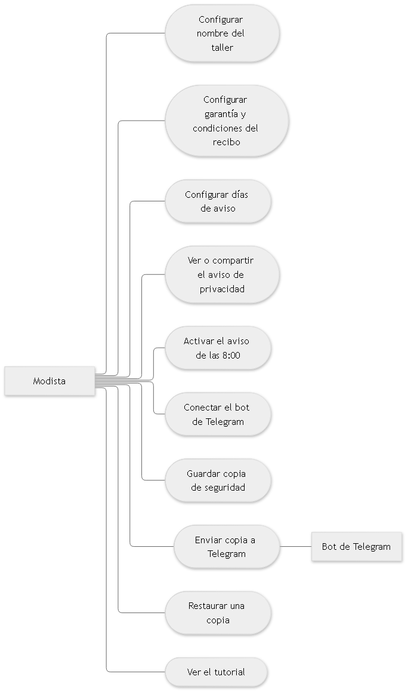
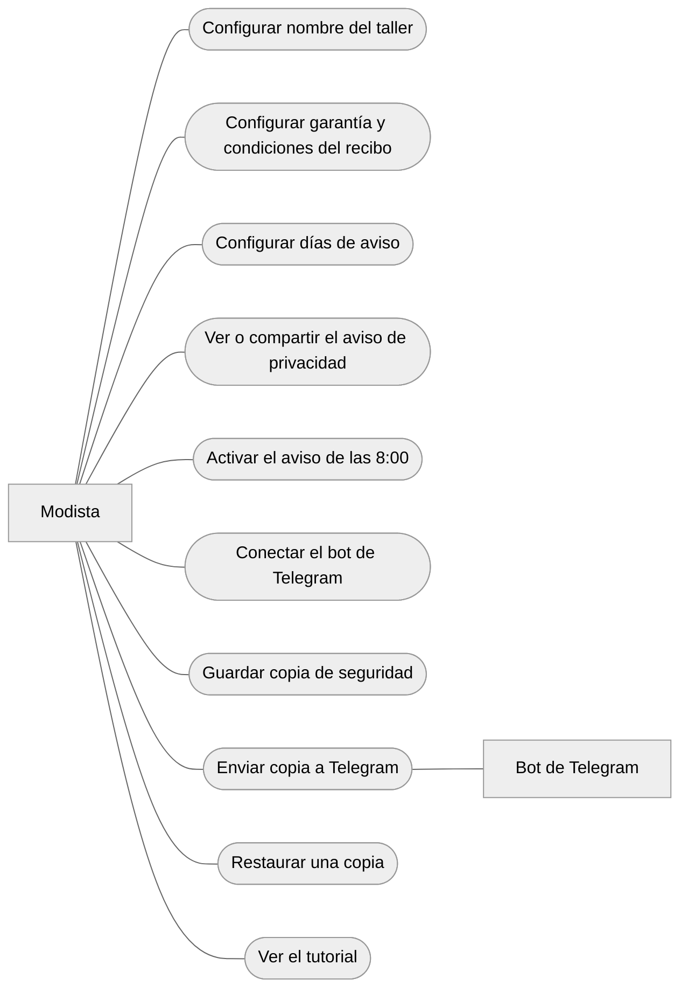
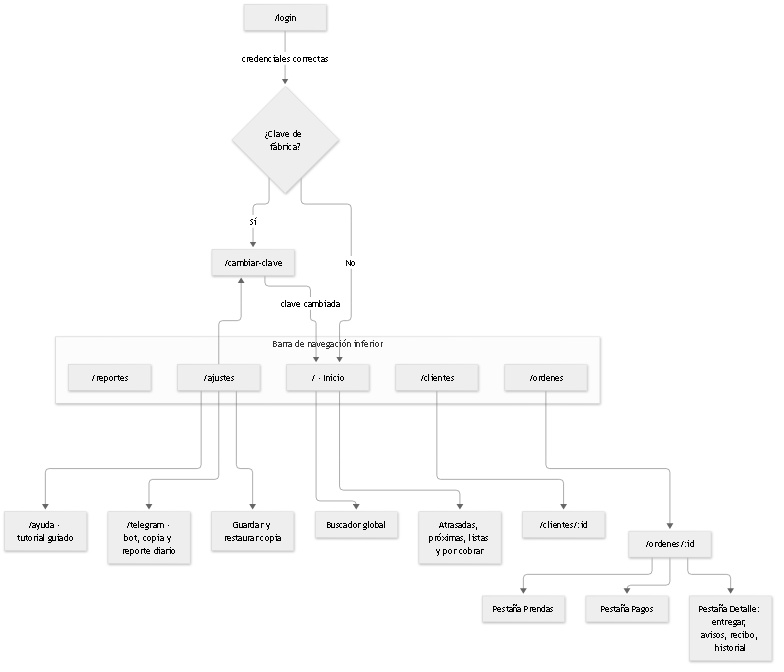
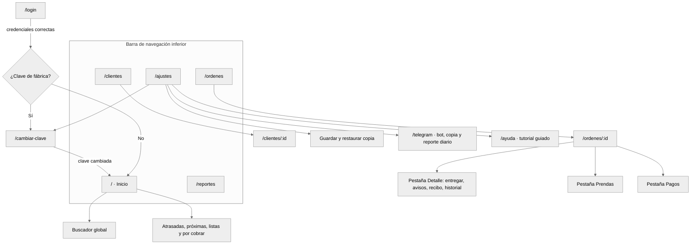

# Diagramas vigentes modificados después de la revisión: fuentes en 4252f22

Copia literal de los bloques Mermaid que cambiaron entre `a2c18ff` y `4252f22`. No sustituye a las fuentes. Las de `a2c18ff` siguen en [fuentes.md](fuentes.md).

## DG-01 · docs/02-diseno/ARQUITECTURA.md:41 · 1

## DG-02 · docs/02-diseno/ARQUITECTURA.md:163 · 2

## DG-03 · docs/02-diseno/ARQUITECTURA.md:203 · 3

## DG-09 · docs/02-diseno/CASOS_DE_USO.md:182 · 6

## DG-13 · docs/02-diseno/COMPORTAMIENTO.md:13 · 1

