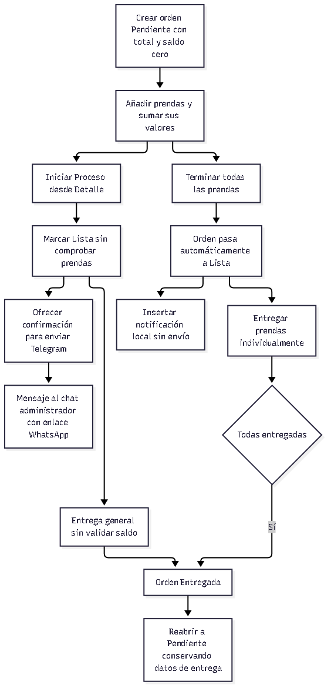
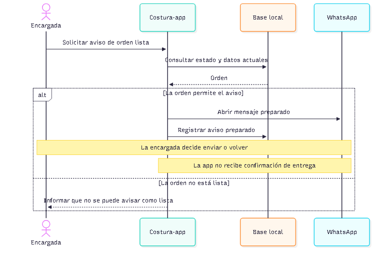
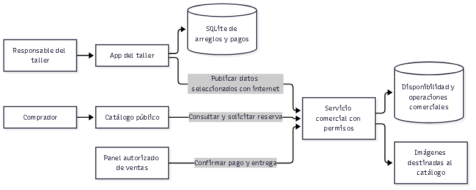
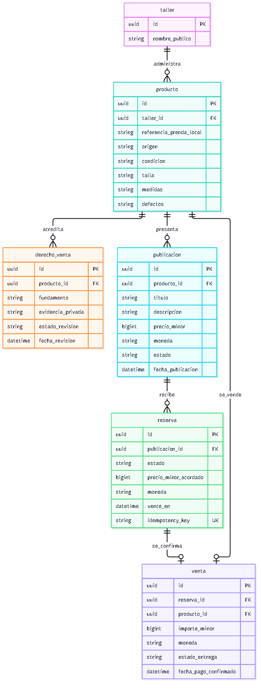
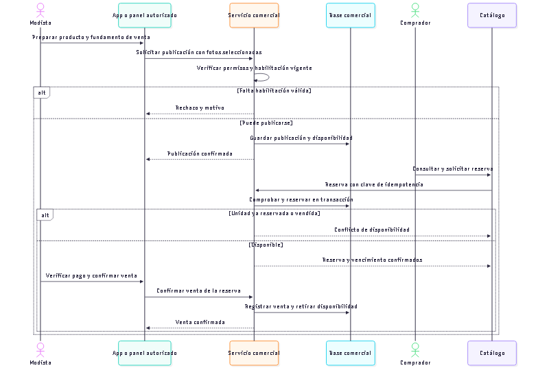
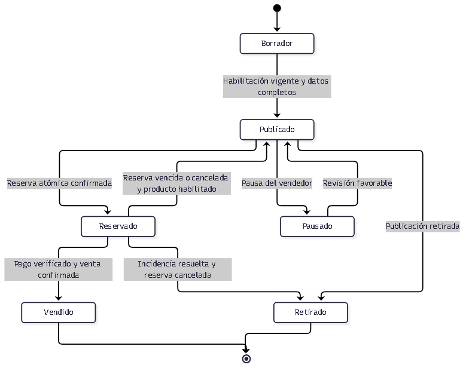
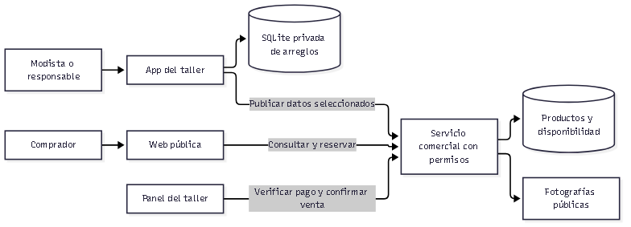
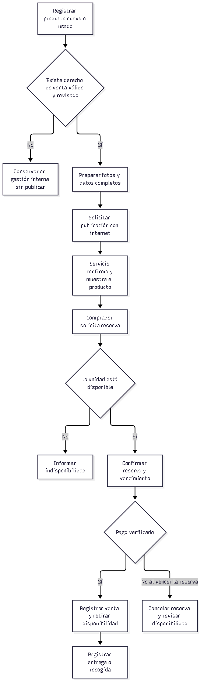
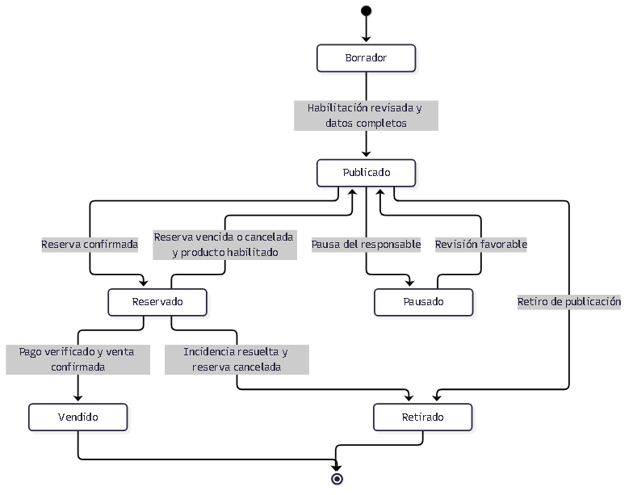

# Diagramas históricos: fuera de alcance vigente

## DH-01 · docs/04-calidad/historico/AUDITORIA_APP_DOCUMENTACION.md

## DH-02 · docs/04-calidad/historico/FALLOS_APP_2026-10-06.md

## DH-03 · docs/04-calidad/historico/REVISION_EQUIPO_ANALISTAS_2026-10-07.md

## DH-04 · docs/99-archivo/propuesta-venta/ARQUITECTURA.md

## DH-05 · docs/99-archivo/propuesta-venta/ARQUITECTURA.md

## DH-06 · docs/99-archivo/propuesta-venta/ARQUITECTURA.md

## DH-07 · docs/99-archivo/propuesta-venta/ARQUITECTURA.md

## DH-08 · docs/99-archivo/PROPUESTA_WEB_APP.md

## DH-09 · docs/99-archivo/PROPUESTA_WEB_APP.md

## DH-10 · docs/99-archivo/PROPUESTA_WEB_APP.md

