# Diagramas vigentes: copia para revisión

No sustituye a las fuentes. Extraídos sin cambiar su contenido.

## DG-01 · docs/02-diseno/ARQUITECTURA.md · 1

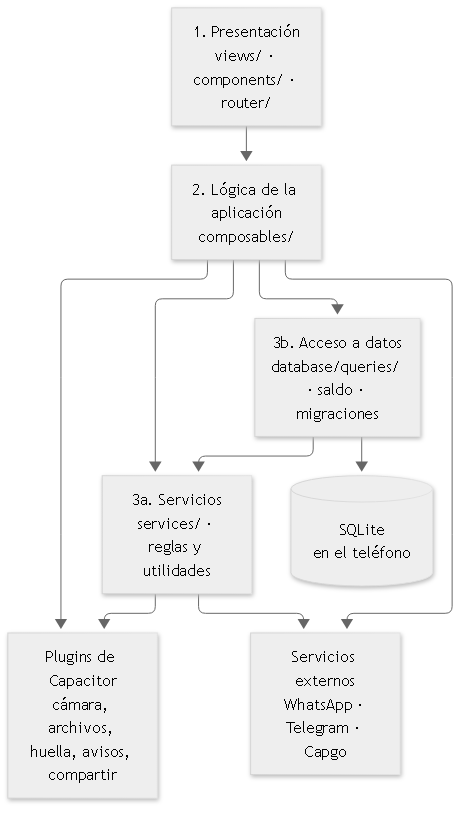

## DG-02 · docs/02-diseno/ARQUITECTURA.md · 2

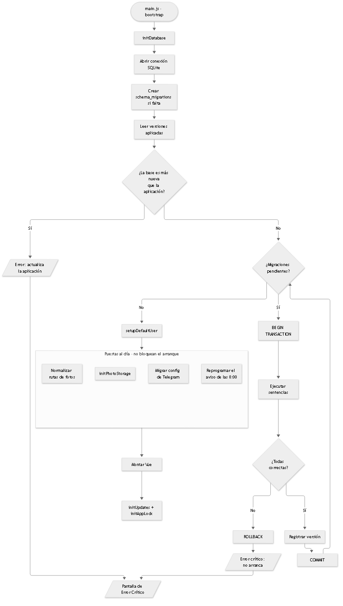

## DG-03 · docs/02-diseno/ARQUITECTURA.md · 3

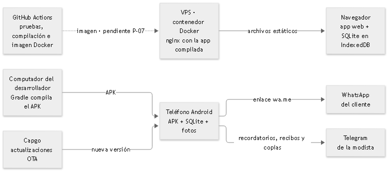

## DG-04 · docs/02-diseno/CASOS_DE_USO.md · 1

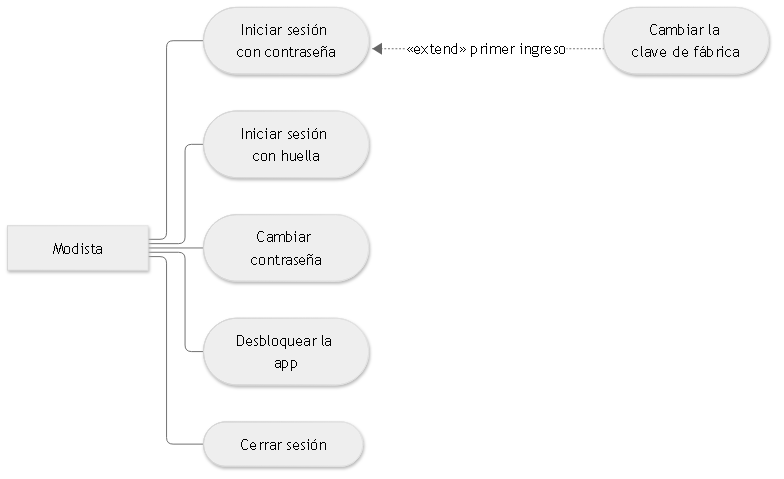

## DG-05 · docs/02-diseno/CASOS_DE_USO.md · 2

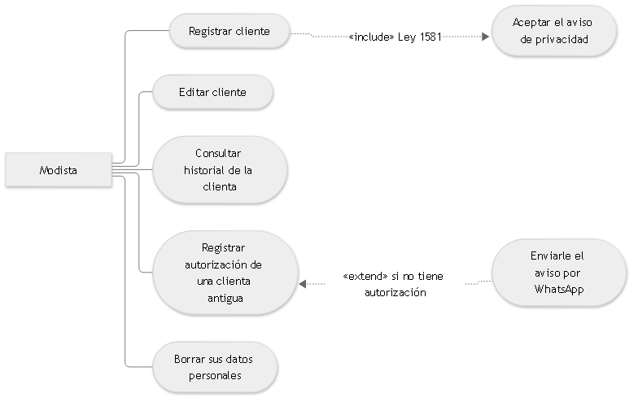

## DG-06 · docs/02-diseno/CASOS_DE_USO.md · 3

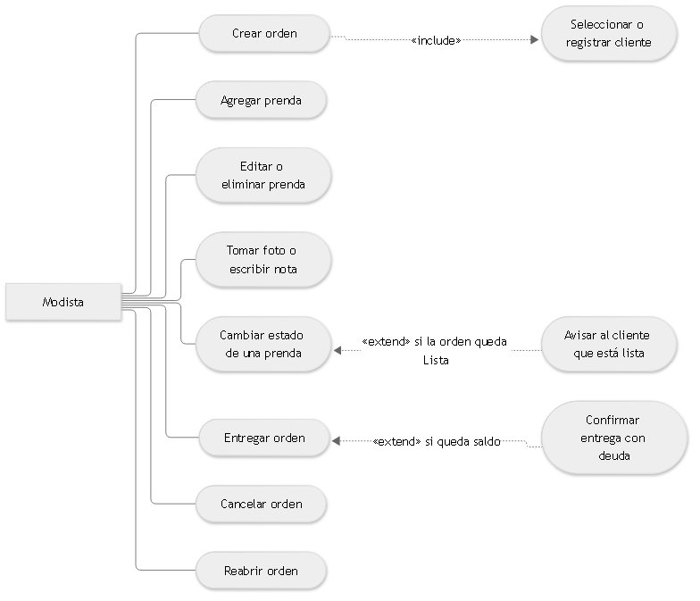

## DG-07 · docs/02-diseno/CASOS_DE_USO.md · 4

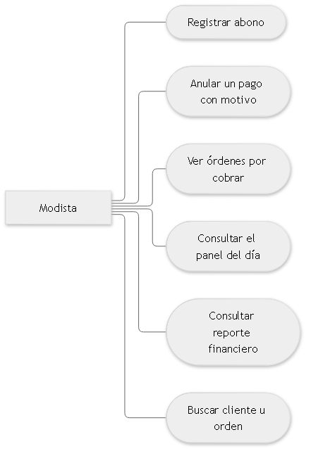

## DG-08 · docs/02-diseno/CASOS_DE_USO.md · 5

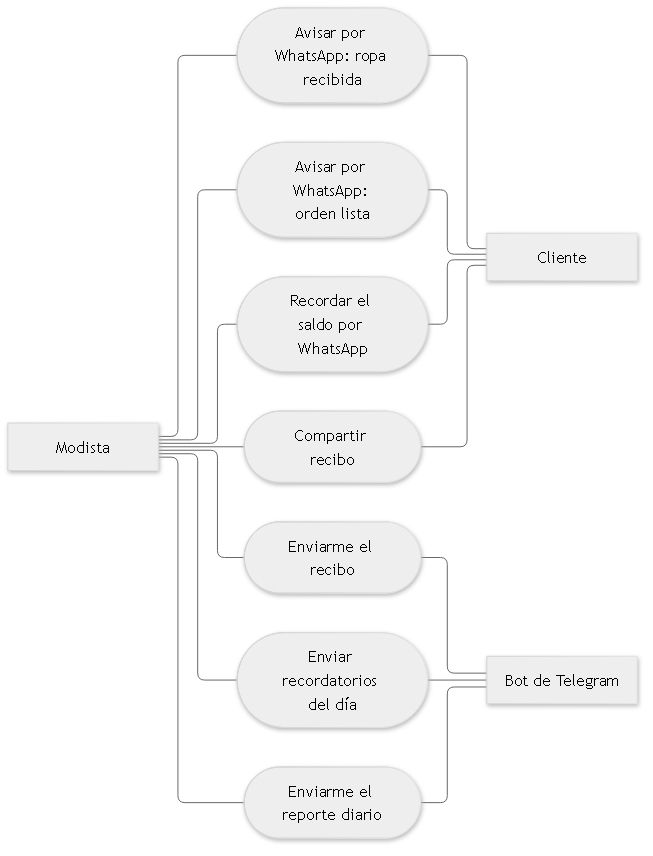

## DG-09 · docs/02-diseno/CASOS_DE_USO.md · 6

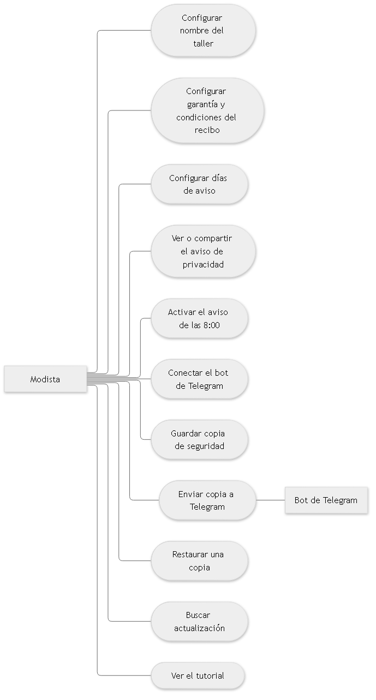

## DG-10 · docs/02-diseno/CASOS_DE_USO.md · 7

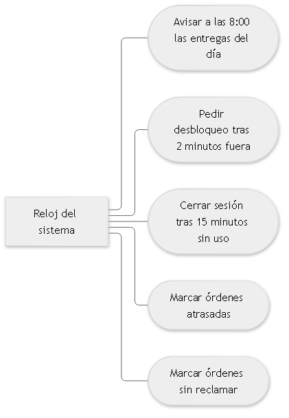

## DG-11 · docs/02-diseno/CASOS_DE_USO.md · 8

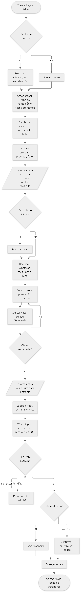

## DG-12 · docs/02-diseno/CLASES.md · 1

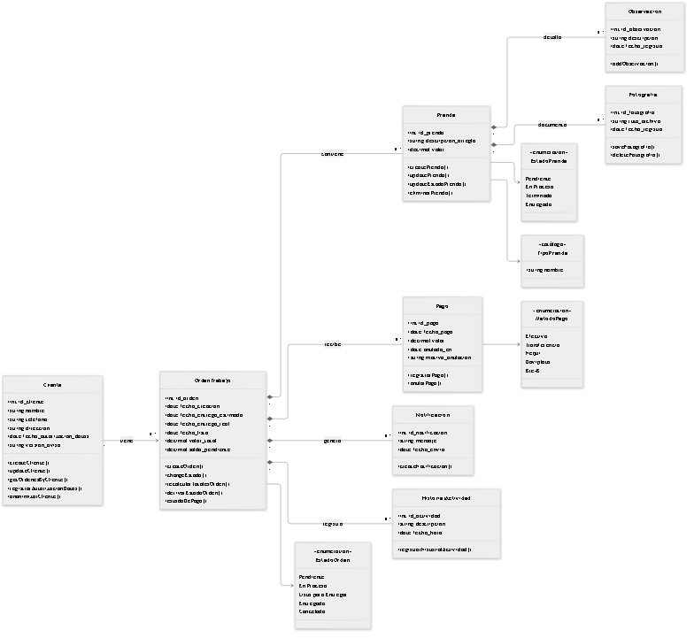

## DG-13 · docs/02-diseno/COMPORTAMIENTO.md · 1

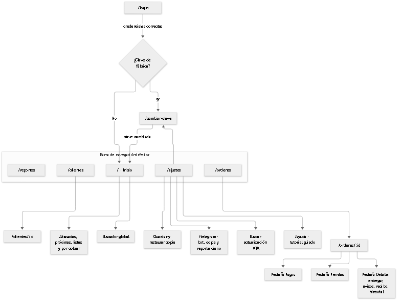

## DG-14 · docs/02-diseno/COMPORTAMIENTO.md · 2

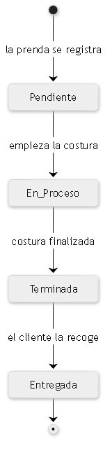

## DG-15 · docs/02-diseno/COMPORTAMIENTO.md · 3

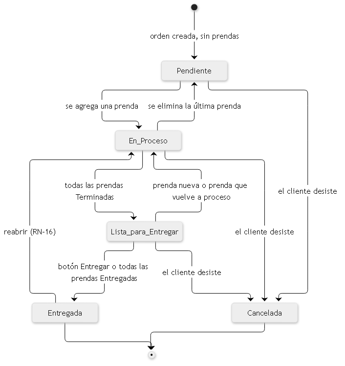

## DG-16 · docs/02-diseno/COMPORTAMIENTO.md · 4

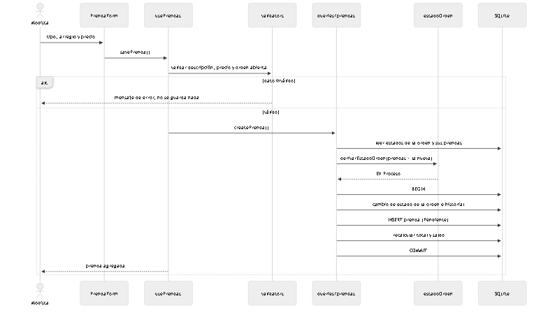

## DG-17 · docs/02-diseno/COMPORTAMIENTO.md · 5

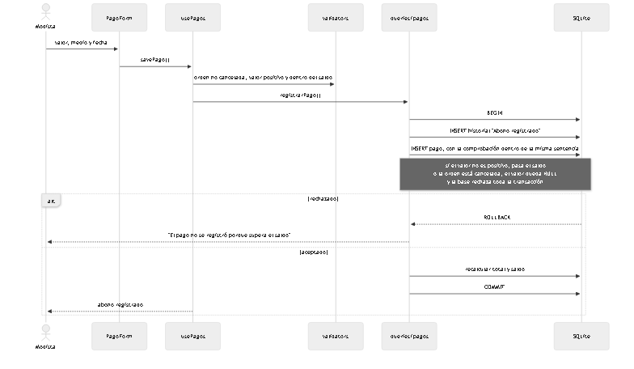

## DG-18 · docs/02-diseno/COMPORTAMIENTO.md · 6

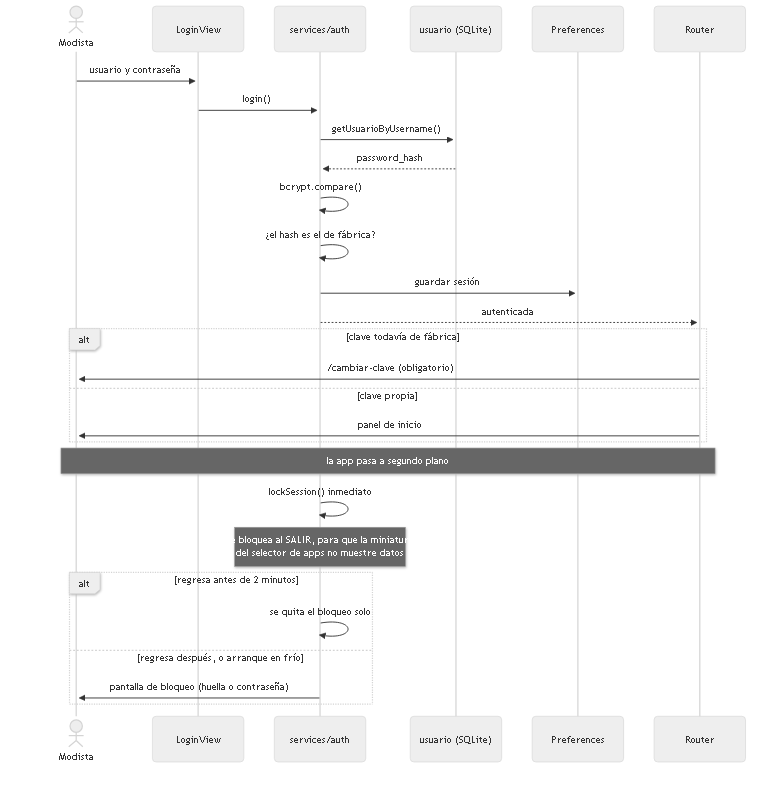

## DG-19 · docs/02-diseno/COMPORTAMIENTO.md · 7

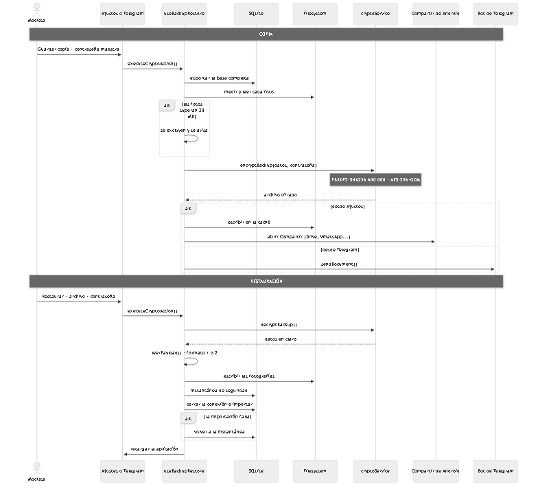

## DG-20 · docs/02-diseno/MODELO_DE_DATOS.md · 1

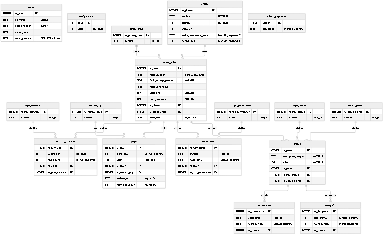
